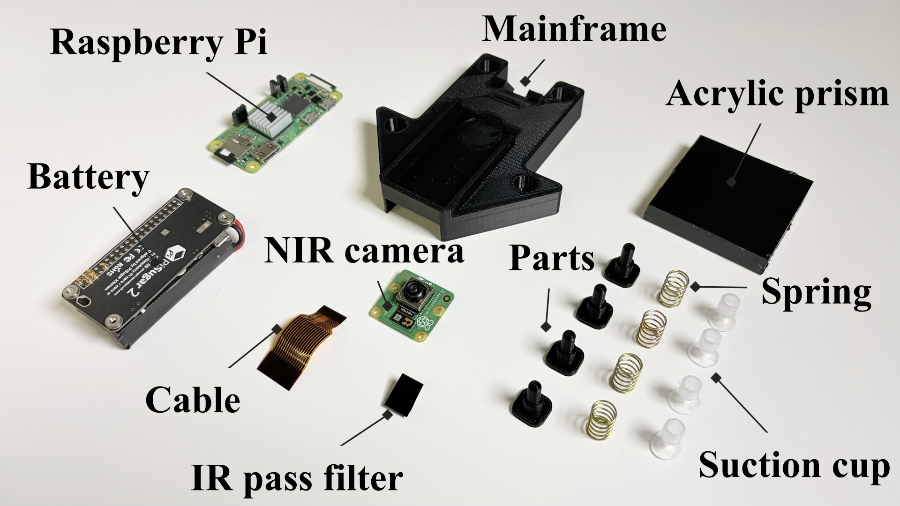

# ReFTIR

Hardware and software of ReFTIR, a multitouch sensing device based on repropagated FTIR (RFTIR), presented in the paper below.

> Kotaro Kitada and Kentaro Takemura. 2026. **ReFTIR: Multitouch Sensing using FTIR Images Reconstructed based on Repropagated FTIR.** *Proc. ACM Hum.-Comput. Interact.* 10, 8, Article ISS033 (November 2026), 21 pages. https://doi.org/10.1145/3859345

## Contents

| Folder | Description |
| --- | --- |
| [`Hardware/`](Hardware/) | 3D models of the measurement device (STEP and STL) |
| [`Software/`](Software/) | Post-processing program that reconstructs contact positions from RFTIR images |

## Hardware



### 3D Models

Each part is provided in two formats:

- **STEP** (`.step`): editable solid model that opens in most CAD software. Use it to modify the design.
- **STL** (`.stl`): mesh for 3D printing. GitHub can preview it in the browser.

| Part | Description | STEP | STL |
| --- | --- | --- | --- |
| Main frame | Main frame of the measurement device | [`mainframe.step`](Hardware/mainframe.step) | [`mainframe.stl`](Hardware/mainframe.stl) |
| Parts4fixed | Suction-cup mount (print 4; labeled "Parts" in the photo above) | [`Parts4fixed.step`](Hardware/Parts4fixed.step) | [`Parts4fixed.stl`](Hardware/Parts4fixed.stl) |

All parts were printed in PLA on a Raise3D Pro (FDM). No special print settings are required.

### Parts List

| Part | Product / Specification | Manufacturer | Qty |
| --- | --- | --- | --- |
| Prism | Polished-finish acrylic, 50 × 50 × 10 mm | Unknown | 1 |
| Single-board computer | Raspberry Pi Zero 2 W | Raspberry Pi Foundation, UK | 1 |
| Battery | PiSugar 2 Portable 1200 mAh | PiSugar, CN | 1 |
| Camera | Raspberry Pi Camera Module V3 NoIR Wide | Raspberry Pi Foundation, UK | 1 |
| Camera cable | Raspberry Pi Zero Mini Camera Cable, 38 mm | Raspberry Pi Foundation, UK | 1 |
| Visible-light cut filter | FUJIFILM IR-76 | FUJIFILM | 1 |
| Spring | Wire diameter 0.6 mm, outer diameter 8.5 mm, free length 14 mm | WAKI SANGYO CO., LTD. | 4 |
| Suction cup | Radius 5 mm | YAHATA NEJI CO., LTD. | 4 |
| Paraffin | Paraffin Liquid, High Viscosity Type | NACALAI TESQUE, INC., JP | As needed |
| Paint | Black acrylic spray, for painting the prism | — | As needed |

Notes:

- Paint four faces of the prism black: all faces except the side face observed by the camera and the bottom face that is attached.
- High-viscosity paraffin is recommended.
- The suction-cup mount may be made somewhat larger, as long as the main frame is adjusted to fit.

## Software

The program reconstructs contact positions on the contact plane from differential RFTIR images using a lookup table (LUT), and clusters them with DBSCAN. It requires CMake 3.16 or later, a C++17 compiler, and OpenCV 4.

See [`Software/README.md`](Software/README.md) for the processing flow, build instructions, and usage.

## License

Copyright (c) 2026 [Human Sensing Group](https://takemura-lab.org/)

- Software (`Software/`): [MIT License](LICENSE)
- Hardware design files (`Hardware/`): [CERN-OHL-P-2.0](Hardware/LICENSE)

The hardware design files describe Open Hardware and are licensed under the CERN-OHL-P v2. You may redistribute and modify them and make products using them under the terms of the CERN-OHL-P v2 (https://cern.ch/cern-ohl).

OpenCV is used under the Apache License 2.0 and is not included in this repository.

## Citation

If you use this repository, please cite the following paper:

```bibtex
@article{10.1145/3859345,
  author    = {Kitada, Kotaro and Takemura, Kentaro},
  title     = {ReFTIR: Multitouch Sensing using FTIR Images Reconstructed based on Repropagated FTIR},
  journal   = {Proc. ACM Hum.-Comput. Interact.},
  year      = {2026},
  month     = nov,
  volume    = {10},
  number    = {8},
  articleno = {ISS033},
  numpages  = {21},
  publisher = {Association for Computing Machinery},
  address   = {New York, NY, USA},
  doi       = {10.1145/3859345},
  url       = {https://doi.org/10.1145/3859345}
}
```
